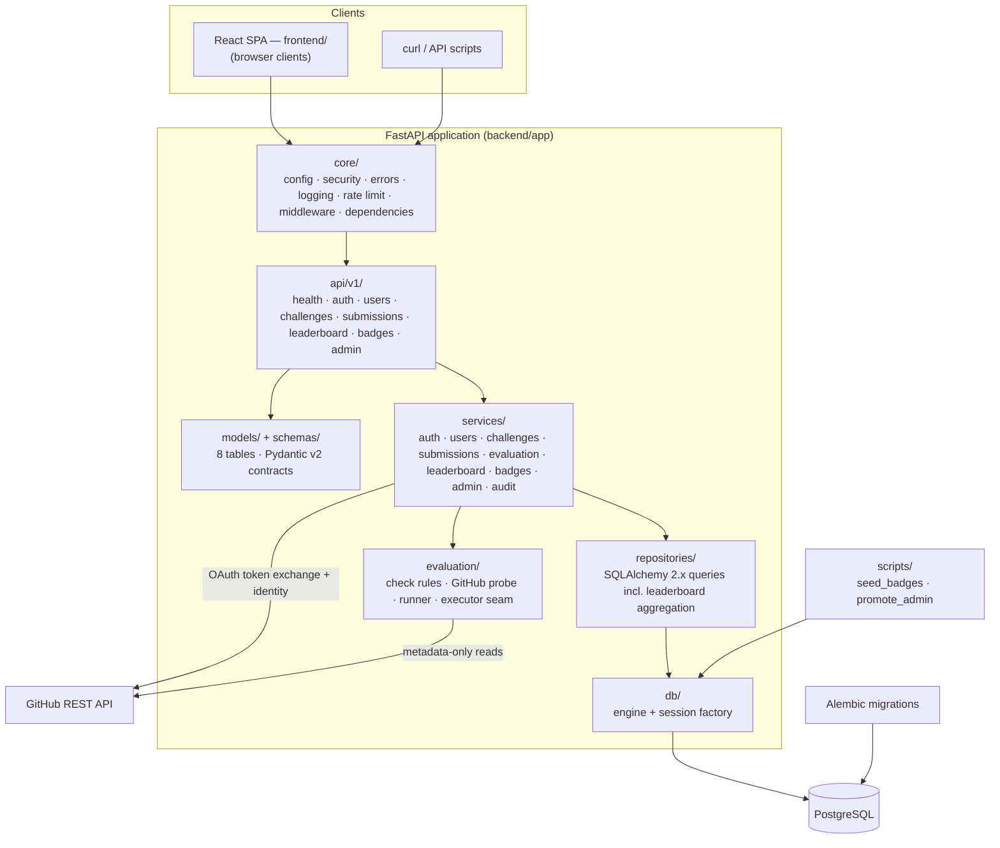
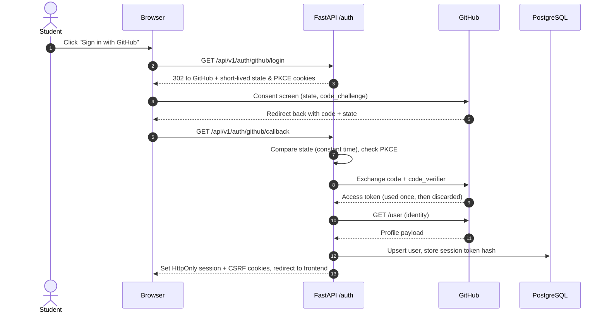
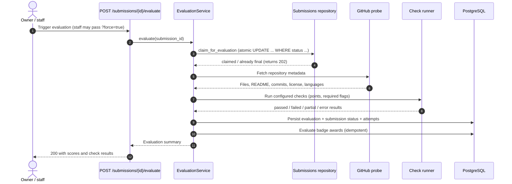

# Architecture — GDG TUM Build Arena backend

How the backend is put together, how requests flow through it, and where the
extension points are. Setup instructions live in
[`backend/README.md`](../backend/README.md); the security design lives in
[`SECURITY.md`](SECURITY.md).

## System context

A single FastAPI service owns all business logic and persistence. PostgreSQL is
the only stateful dependency; GitHub is an external dependency for OAuth and
repository metadata used by evaluations. There is no Redis, message broker or
worker process in the MVP.

Module responsibilities:

| Path | Responsibility |
| --- | --- |
| `app/main.py` | App factory, middleware stack, error handlers (including the 404 envelope) |
| `app/api/v1/` | HTTP surface: validation, dependencies, status codes; one module per resource |
| `app/core/` | Settings, security helpers (hashing, cookies), session/user dependencies, RBAC, rate limiting, logging, middleware, error envelope |
| `app/services/` | Business rules and orchestration (auth, users, challenges, submissions, evaluation, leaderboard, badges, admin, audit) |
| `app/repositories/` | Database queries, including the atomic submission claim and the leaderboard aggregation |
| `app/evaluation/` | Check definitions (`rules.py`), GitHub metadata probe (`probe.py`), scoring runner (`runner.py`), executor seam (`executor.py`) |
| `app/integrations/github.py` | GitHub OAuth + REST client (timeouts, bounded retries, per-request caching) |
| `app/models/` | SQLAlchemy models, enums and status groupings |
| `app/schemas/` | Pydantic request/response contracts and the shared page/error envelopes |
| `migrations/` | Alembic environment and revisions (initial revision `b3eafbacb03b`) |
| `scripts/` | Operational scripts (`seed_badges`, `promote_admin`) |

## Request flow

1. Uvicorn passes the request to the ASGI app built by `create_app()`
   (`app/main.py`). Middleware applies CORS, host checks, CSRF verification for
   cookie-authenticated mutations, rate limiting and request logging.
2. Router dependencies resolve the caller: session cookie (or
   `Authorization: Bearer` for API clients) → session record → user; role and
   ownership checks happen per endpoint.
3. Routers delegate to services; services use repositories for persistence and
   the evaluation subsystem for scoring work.
4. Responses are Pydantic schemas: lists use the page envelope
   (`items`/`total`/`page`/`page_size`/`pages`); every error – including 404s
   for unknown routes – uses the machine-readable error envelope.
5. Every privileged or score-affecting mutation writes an `audit_logs` row with
   sanitized metadata.

## Authentication flow (GitHub OAuth)

The callback exchanges the authorization code with PKCE and immediately
discards the GitHub access token; only the identity is read.

## Evaluation pipeline

Evaluations are metadata-only. The engine reads repository metadata (existence,
visibility, files, README, commits, license, languages) through the GitHub REST
API. Student code is never cloned or executed.

Key properties:

- **Idempotent triggers** — a submission with an evaluation in flight
  (`queued`/`running`) returns `202` instead of double-running; staff can force
  a re-run of a final submission (`?force=true`, audited).
- **Statuses** — submissions move through
  `pending → (queued) → running → passed | failed | error`; `queued` exists for
  a future queue-backed executor. Evaluations are `running → completed | error`.
- **Scoring** — partial credit sums passed check points; required checks gate a
  `passed` outcome; an errored check marks the run `error`, contributes zero and
  is excluded from the leaderboard but can be re-run.
- **Retries** — multiple attempts per challenge are allowed (cooldown + daily
  cap); each run is a separate `evaluations` row and `evaluation_attempts` is
  incremented on the submission.

Authoritative details for scoring, leaderboard counting (best attempt per user
and challenge, override precedence, tie-breaks) and badges are documented in
[`backend/README.md`](../backend/README.md#scoring-and-evaluation).

## Data model

Eight tables, created by Alembic migration `b3eafbacb03b`. All timestamps are
timezone-aware UTC; enum-like columns are `VARCHAR` with explicit `CHECK`
constraints.

| Table | Purpose | Key constraints & relationships |
| --- | --- | --- |
| `users` | Accounts and roles | `github_id`, `github_username` unique; role/status checks; 1→N sessions, submissions, badges |
| `auth_sessions` | Server-side sessions | Unique SHA-256 `token_hash` (raw token never stored); FK → `users` `CASCADE`; `expires_at`, `revoked_at` |
| `challenges` | Challenge catalogue | Unique `slug`; status/difficulty checks; `max_points` 1–10 000; optional schedule window; JSONB `evaluation_config`; `created_by` FK `SET NULL` |
| `submissions` | Student attempts | FKs → `users`/`challenges` `CASCADE`; lifecycle status; `points_awarded`; JSONB `results`; moderation (disqualification) and score-override fields; `evaluation_attempts` |
| `evaluations` | One row per evaluation run | FK → `submissions` `CASCADE`; JSONB `checks`; `max_score`/`awarded_score`; `evaluator_version` |
| `badges` | Badge catalogue | Unique `slug`/`name`; JSONB `criteria` rule; `is_active` |
| `user_badges` | Awarded badges | Unique `(user_id, badge_id)`; badge FK `RESTRICT`; user FK `CASCADE`; `awarded_by` `SET NULL` |
| `audit_logs` | Privileged-action trail | Sanitized JSONB metadata; actor FK `SET NULL`; indexes by action/actor/target/time |

Deletion policy: deleting a user cascades to their sessions, submissions and
awards (and anonymizes audit references via `SET NULL`); deleting a challenge
cascades to its submissions; deleting a submission cascades to its evaluations.
Badges cannot be deleted while awarded (`RESTRICT`). In normal operation,
accounts are deactivated (`users.is_active = false`) instead of deleted, and
leaderboards exclude inactive users.

## Deployment topology

- **Local development** — `docker compose up --build`: PostgreSQL 16 + the API
  image; the container start command applies migrations, seeds badges and
  serves Uvicorn. Ports are overridable (`POSTGRES_PORT`, `API_PORT`).
- **Production (planned/documented)** — one API container (or native Python
  service) plus managed PostgreSQL. Migrations run as a separate release step;
  the platform healthcheck targets `/health`; set `ENVIRONMENT=production`
  (enables secure cookies and strict config validation) and
  `TRUST_PROXY_HEADERS=true` only behind a trusted reverse proxy.
- **Scaling caveat** — the in-process rate limiter is per instance; apply
  platform-level limits when running more than one instance or worker. The
  leaderboard and evaluation claims are safe under concurrency thanks to the
  atomic claim `UPDATE` and best-attempt aggregation.

## Extension points

Designed-for seams (no behavior change required in the API layer):

1. **`EvaluationExecutor`** — replace `SynchronousExecutor` with a queue-backed
   executor; the atomic claim in the repository already prevents double-runs,
   and `queued` is part of the status model.
2. **Rate limiter** — the sliding-window limiter sits behind a small interface;
   a Redis-backed implementation can replace it when scaling horizontally.
3. **Repositories** — all SQL is isolated from HTTP handlers; query changes
   (indexes, aggregation) do not touch routers.
4. **GitHub client** — timeouts, retries and the optional server-side token are
   centralized in `app/integrations/github.py`.

## Non-goals (MVP)

- Server-rendered pages — the platform is an API plus a client-side SPA that
  lives in [`frontend/`](../frontend/README.md).
- Executing or sandboxing student code — only metadata is inspected.
- Manual-review check types, exports and notifications.
- Multi-tenant or per-organization isolation.
